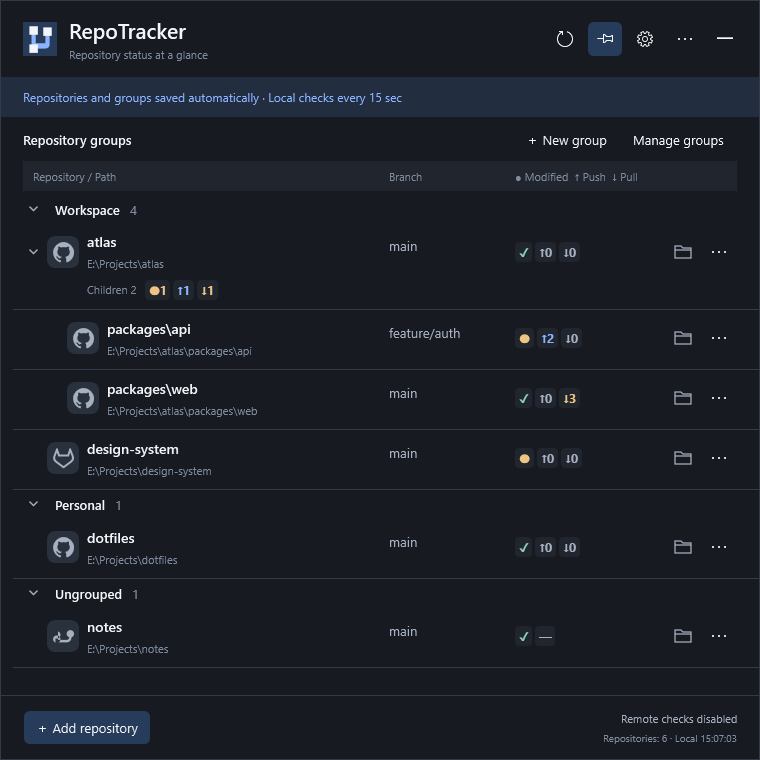
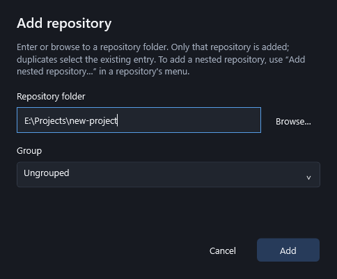
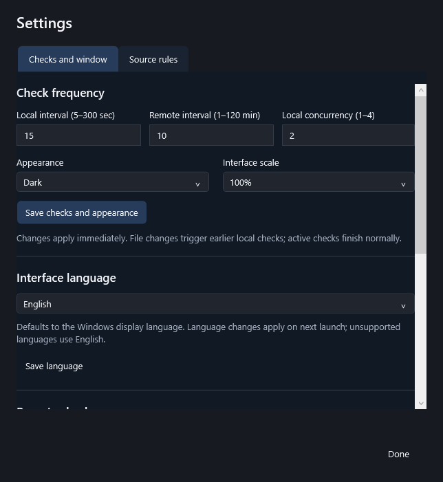
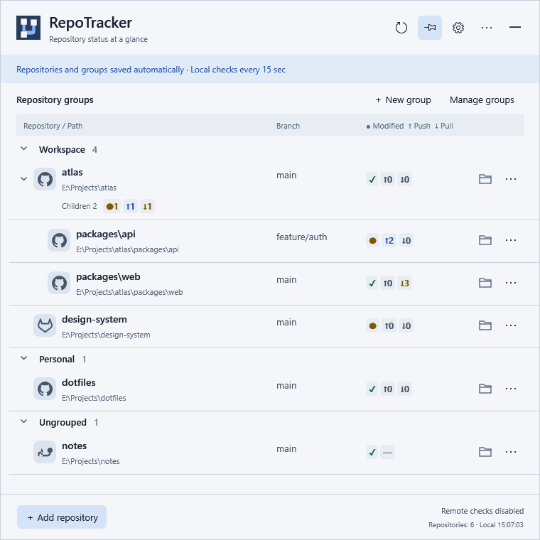

# RepoTracker

**Your local Git repositories, at a glance.**

English · [简体中文](README.zh-CN.md)

RepoTracker is a Windows system tray app that keeps repository status within reach. See branches, uncommitted changes, and commits ahead of or behind the locally known upstream, grouped the way you work.



*Actual application UI with fictional repositories and sample statuses. Remote checks are off in these screenshots.*

## What it does

- Tracks repositories you add, including nested repositories, initialized submodules, and linked worktrees.
- Shows GitHub, GitLab, and custom host icons alongside branch and status indicators.
- Organizes repositories into groups and expandable directory trees. Collapsed parents still show a summary of their tracked descendants.
- Refreshes local status in the background; optional remote checks fetch updated information.
- Opens repository folders and removes entries from the tracker without deleting repository files.
- Offers dark and light themes, 100% / 125% / 150% interface scaling, and English / Simplified Chinese.

RepoTracker does not run commit, push, pull, or stash, or change your working files, branches, or upstream configuration. **Remote checks are off by default.** Enabling them allows fetch operations that download Git objects and update Git metadata, including remote-tracking refs.

## Install

Check [GitHub Releases](https://github.com/vent0s/RepoTracker/releases) for published Windows x64 builds. Until the first release is available, use the [source build instructions](#build-from-source).

| Download | Use it for |
| --- | --- |
| `RepoTracker-<version>-win-x64-Setup.exe` | Recommended installation for the current Windows user, with a Start menu entry, upgrades, and an uninstaller. |
| `RepoTracker-<version>-win-x64.zip` | Portable use: extract the **entire** ZIP to a stable folder and run `RepoTracker.Desktop.exe`. |
| Matching `.sha256` file | Verify the downloaded package with `Get-FileHash <file> -Algorithm SHA256`. |

You need **Windows x64** and [Git for Windows](https://git-scm.com/downloads/win) available on `PATH`. Check with `git --version`; restart RepoTracker if you have just installed Git. Release packages include the .NET / WPF runtime, so a separate .NET installation is not needed to run them.

Current validation covers Windows 10 x64 on the development machine. Windows 11 and physical high / mixed DPI displays still need validation; see the [compatibility record (Chinese)](doc/兼容性与发布说明.md). Packages are currently unsigned, so Windows may identify the publisher as unknown.

## Get started

1. Install and launch RepoTracker from the Start menu, or run the extracted portable EXE.
2. Click **Add repository** and browse to a local Git working tree, or paste its folder path. Optionally select a group, then click **Add**.
3. Read the branch and status indicators. Hover over an indicator for details and the time of the last check.
4. Collapse the panel when you are done. Local checks continue in the background. Click the tray icon to open it again; right-click it for settings or exit.



The panel has no taskbar or Alt+Tab entry. If the tray icon is hidden, look in Windows' tray overflow menu and choose to keep it visible. Turn on **Keep open** if you want the panel to remain visible when another app gets focus. Use **Exit** to stop RepoTracker; collapsing the panel leaves it running.

### Read the status

| Indicator | Meaning |
| --- | --- |
| `✓` | The working tree is clean. This alone does not mean the branch is up to date with the remote server. |
| `●` | There are uncommitted changes. |
| `↑n` | The branch is ahead of its locally known upstream by `n` commits. |
| `↓n` | The branch is behind its locally known upstream by `n` commits. |
| `!` | A conflict or check problem; hover for the cause. |
| `?` | Complete status is not available yet. |
| `—` | There is no upstream or no branch comparison is available, such as detached HEAD or a repository without commits. |

`✓` and `—` can appear together: the working tree is clean, but no comparison target is available. A branch without an upstream may still belong to a repository with a remote.

The summary beneath a parent counts **repositories**, not commits. For example, `Children 2 · ●1 ↑1 ↓1` means two tracked descendants, one with changes, one ahead, and one behind. The indicators on each repository's own row count its commits separately.

### Groups and nested repositories

Use **New group** to organize your list. A repository's **More** menu lets you move it to a group or choose **Add nested repository…**. Add each child explicitly; RepoTracker does not scan folders or initialize submodules. Adding an already tracked working tree locates the existing entry instead of duplicating it.

Repositories in the same group follow their directory hierarchy. Click the arrow beside a parent to expand or collapse its descendants. Removing an entry only stops tracking that repository; it does not delete files or remove other tracked entries. Deleting a group moves its repositories to **Ungrouped**.

### Settings, language, and remote checks

Open **Settings → Checks and window** to change local / remote check intervals, theme, scaling, language, and login startup. Local checks default to every 15 seconds. When enabled, remote checks default to every 10 minutes.



- **Language:** the app follows the Windows display language by default, with English fallback for unsupported languages. Choose **English** or **简体中文**, save the language preference, then exit and reopen the app. Documentation defaults to English independently of this setting.
- **Remote checks:** enable them only when you want RepoTracker to fetch. With them off, ahead / behind values use information already present locally and may lag behind the server. Set up Git authentication outside RepoTracker; it does not open credential prompts. A failed remote check keeps the last known result while local checks continue.
- **Source rules:** use this settings tab to add a self-hosted Git service's hostname or wildcard pattern and select an icon.
- **Login startup:** off by default and configured separately on each computer. Scroll down in **Checks and window** to enable it. Login startup opens the tray icon without showing the panel.

<details>
<summary>Light theme</summary>



</details>

## Update, data, and removal

**Installed version:** run a newer Setup to update the same installation directory. Your repository list and preferences are retained. There is no background update downloader. Uninstall through Windows Settings; external profile data and tracked repositories are retained.

**Portable version:** exit the running app, extract the new ZIP into an empty folder, and launch it with the same profile. Keep the old folder as a backup. If you change the application path and use login startup, disable startup in the old copy and enable it in the new one. Before deleting a portable copy, disable its login startup and exit it.

The default data directory is `%LOCALAPPDATA%\RepoTracker`; it contains `state.json`, its backup when present, and `logs/`. Keep profiles separate from application files. For an independent profile, launch with an absolute path:

```powershell
.\RepoTracker.Desktop.exe --profile "E:\RepoTrackerProfiles\work"
```

Only one instance runs per profile. Launching again activates the existing instance, so exit the old version before switching portable builds. Back up your profile before manual migration or downgrade. More details: [installation and upgrades (Chinese)](doc/安装与升级.md), [portable guide (Chinese)](doc/便携版使用说明.md).

## Troubleshooting

- **Git is missing:** run `git --version` in a terminal and restart the app after updating `PATH`.
- **A repository is unreachable:** check that its folder or drive is available. The tracked entry is retained.
- **Ahead / behind seems stale:** fetch in your usual Git client, or enable RepoTracker's remote checks.
- **Remote authentication fails:** verify access with your usual Git tools first, including SSH host confirmation where needed.
- **A setting cannot be saved:** check profile write access. Keep a backup before investigating configuration files.

Report problems through [GitHub Issues](https://github.com/vent0s/RepoTracker/issues), including the app version, Windows version, display scale, and reproduction steps. Logs are in the profile's `logs/` folder; review paths and other personal information before sharing them.

## Build from source

Use Windows, Git, and the **.NET SDK version pinned in [global.json](global.json)**. The desktop app uses C# and WPF.

```powershell
git clone https://github.com/vent0s/RepoTracker.git
cd RepoTracker
dotnet restore RepoTracker.slnx --locked-mode
dotnet build RepoTracker.slnx --configuration Release --no-restore
dotnet run --project src/RepoTracker.Desktop/RepoTracker.Desktop.csproj --configuration Release --no-build
```

From an existing source checkout, start at `dotnet restore`.

For a portable package, run `pwsh -NoProfile -File ./publish-win-x64.ps1 -PortableOnly`. Omit `-PortableOnly` to also build Setup; this needs the Inno Setup version specified in the [installation guide](doc/安装与升级.md). Build output goes under `publish/`.

Developer references: [development and verification (Chinese)](doc/开发与运行.md), [technical design (Chinese)](doc/技术设计.md), [interaction design (Chinese)](doc/交互设计.md), [screenshot generation](doc/images/README.md).

## License and acknowledgments

A project license has not yet been selected. See [third-party notices](THIRD-PARTY-NOTICES.md) for dependency and icon attribution; those notices do not grant a license to RepoTracker itself.
