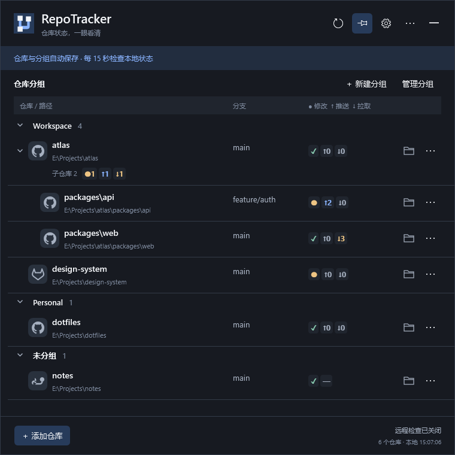
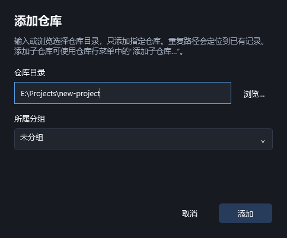
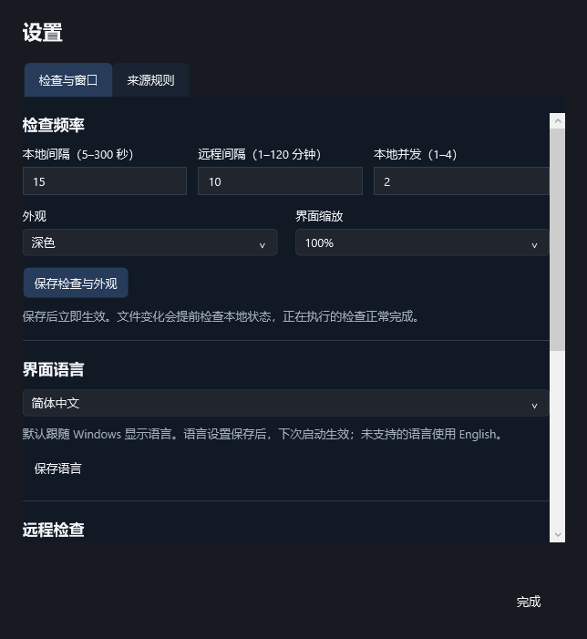
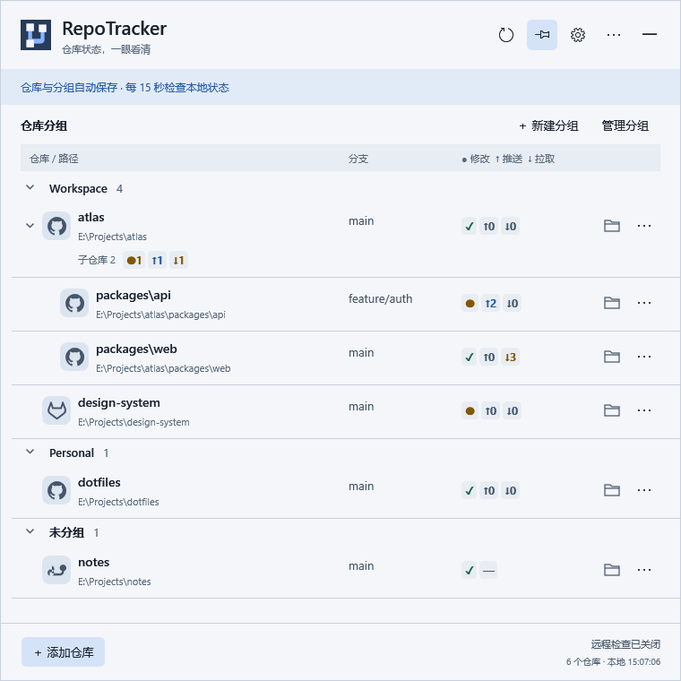

# RepoTracker

**一眼掌握本机 Git 仓库状态。**

[English](README.md) · 简体中文

RepoTracker 是一款 Windows 托盘应用，集中展示你添加的本地仓库：当前分支、未提交变更，以及相对本地已知上游的领先 / 落后提交。可以按工作习惯分组，并展开查看子仓库。



*截图来自实际应用界面，仓库与状态均为示例数据；截图中的远程检查处于关闭状态。*

## 功能

- 手动跟踪本地仓库，包括嵌套仓库、已初始化的 submodule 和 linked worktree。
- 显示 GitHub、GitLab、自定义主机来源，以及分支和状态图标。
- 按分组与目录层级组织仓库，父仓库折叠后仍显示所有已跟踪后代的状态汇总。
- 后台更新本地状态，可选开启远程 fetch 检查。
- 快速打开仓库文件夹；移除跟踪不会删除仓库文件。
- 支持深色 / 浅色主题、100% / 125% / 150% 界面缩放，以及英文 / 简体中文。

应用不执行 commit、push、pull、stash，也不修改工作区文件、分支或 upstream 配置。**远程检查默认关闭。** 主动开启后，fetch 会下载 Git 对象并更新远程跟踪引用等 Git 元数据。

## 安装

在 [GitHub Releases](https://github.com/vent0s/RepoTracker/releases) 查看已发布的 Windows x64 安装包。首次发布前，可以按下方[从源码运行](#从源码运行)的步骤构建。

| 下载文件 | 用途 |
| --- | --- |
| `RepoTracker-<版本>-win-x64-Setup.exe` | 推荐。当前用户安装，提供开始菜单、原位升级和卸载入口。 |
| `RepoTracker-<版本>-win-x64.zip` | 便携使用：**完整解压**到固定文件夹后运行 `RepoTracker.Desktop.exe`。 |
| 对应 `.sha256` 文件 | 用 `Get-FileHash <文件> -Algorithm SHA256` 核对下载文件。 |

需要 **Windows x64**，并安装已加入 `PATH` 的 [Git for Windows](https://git-scm.com/downloads/win)。先确认终端能运行 `git --version`；如果刚安装 Git，请重启 RepoTracker。发布包包含 .NET / WPF 运行时，无需另行安装 .NET。

当前验证覆盖开发机上的 Windows 10 x64；Windows 11、物理高 DPI / 混合 DPI 显示器仍待实测，具体见[兼容性记录](doc/兼容性与发布说明.md)。安装包目前未签名，Windows 可能提示未知发布者。

## 首次使用

1. 安装后从开始菜单启动 RepoTracker，或运行完整解压的便携版 EXE。
2. 点击**添加仓库**，浏览选择本地 Git 工作树或粘贴路径；可以选择分组，再点击**添加**。
3. 查看分支和状态图标。悬停可查看具体含义与上次检查时间。
4. 用完后收起面板，后台检查仍会继续。单击托盘图标重新打开；右键托盘可以打开设置或退出。



主面板不占任务栏，也不出现在 Alt+Tab 中。找不到托盘图标时，请展开 Windows 右下角的隐藏图标菜单，并自行选择让它常驻显示。开启**保持展开**后，切换到其他应用不会自动收起。需要结束后台检查时使用**退出**；收起不等于退出。

### 看懂状态

| 图标 | 含义 |
| --- | --- |
| `✓` | 工作区干净；不单独代表已经与远端服务器同步。 |
| `●` | 有未提交变更。 |
| `↑n` | 相对本地已知上游领先 `n` 个提交。 |
| `↓n` | 相对本地已知上游落后 `n` 个提交。 |
| `!` | 冲突或检查异常，悬停查看原因。 |
| `?` | 尚未取得完整状态。 |
| `—` | 未设置上游，或当前无法比较，例如分离 HEAD、仓库尚无提交。 |

`✓` 和 `—` 可以同时出现：工作区干净，但当前没有比较目标。未设置上游不等于仓库没有 remote。

父仓库下方的汇总按**仓库数**计数。例如“子仓库 2 · ●1 ↑1 ↓1”表示两个已跟踪后代，其中一个有修改、一个领先、一个落后。每个仓库本行的 `↑n`、`↓n` 则是该仓库的提交数。

### 分组与子仓库

使用**新建分组**整理列表。仓库行的**更多**菜单可以移动分组或**添加子仓库…**。每个子仓库都要明确添加；应用不扫描目录，也不初始化子模块。重复添加相同工作树时，会定位已有条目而不重复创建。

同一分组按实际目录关系显示父子层级，点击父仓库左侧箭头展开或折叠。移除只解除当前仓库的跟踪，不删除文件，也不连带移除其他条目；删除分组会把仓库移到**未分组**。

### 设置、语言与远程检查

进入**设置 → 检查与窗口**调整检查间隔、主题、缩放、语言和登录自启。本地检查默认每 15 秒一次；远程检查开启后默认每 10 分钟一次。



- **语言：**应用默认跟随 Windows 显示语言，不支持的语言回退英文。手动选择 **English** 或**简体中文**，保存语言设置后退出再启动。文档默认英文，与应用语言偏好独立。
- **远程检查：**需要应用执行 fetch 时再开启。关闭时，领先 / 落后基于本地已有数据，可能滞后于服务器。先在应用外配置 Git 认证；RepoTracker 不弹出凭据窗口。远程失败时保留上次结果，本地检查继续。
- **已知来源：**在来源设置页添加自建 Git 服务的主机名或通配规则，并选择图标。
- **登录自启：**默认关闭，需在每台电脑分别设置。在“检查与窗口”向下滚动即可开启；登录时只显示托盘，不弹出主面板。

<details>
<summary>浅色主题</summary>



</details>

## 更新、数据与卸载

**安装版：**运行新版 Setup，在原安装目录升级，保留仓库清单与设置。目前没有后台自动下载更新服务。从 Windows“设置 → 应用”卸载，外部 profile 数据与被跟踪仓库会保留。

**便携版：**退出正在运行的应用，将新 ZIP 解压到空文件夹，再使用相同 profile 启动；保留旧目录作为备份。如果更换程序路径且已开启登录自启，先在旧版关闭，再到新版开启。删除便携版前也应先关闭它的登录自启并退出。

默认数据目录为 `%LOCALAPPDATA%\RepoTracker`，包含 `state.json`、已有的备份以及 `logs/`。配置目录应与程序目录分开。需要独立配置时，用绝对路径启动：

```powershell
.\RepoTracker.Desktop.exe --profile "E:\RepoTrackerProfiles\work"
```

同一个 profile 只运行一个实例，再次启动会唤醒已有进程，因此更换便携版前要先退出旧版。手动迁移或降级前备份 profile。详细步骤见[安装与升级](doc/安装与升级.md)、[便携版使用说明](doc/便携版使用说明.md)。

## 常见问题

- **找不到 Git：**先在终端运行 `git --version`，修改 `PATH` 后重启应用。
- **仓库不可达：**检查目录或磁盘是否可访问，已有跟踪记录会保留。
- **领先 / 落后不够新：**在常用 Git 客户端 fetch，或开启 RepoTracker 的远程检查。
- **远程认证失败：**先用常用 Git 工具确认访问正常，包括必要的 SSH 主机确认。
- **设置无法保存：**检查 profile 是否可写；调查配置文件前保留备份。

通过 [GitHub Issues](https://github.com/vent0s/RepoTracker/issues) 反馈问题，并附应用版本、Windows 版本、显示缩放和复现步骤。日志位于 profile 的 `logs/` 中，分享前请检查个人路径等信息。

## 从源码运行

需要 Windows、Git，以及 [global.json](global.json) 锁定的 **.NET SDK**。桌面端使用 C# / WPF。

```powershell
git clone https://github.com/vent0s/RepoTracker.git
cd RepoTracker
dotnet restore RepoTracker.slnx --locked-mode
dotnet build RepoTracker.slnx --configuration Release --no-restore
dotnet run --project src/RepoTracker.Desktop/RepoTracker.Desktop.csproj --configuration Release --no-build
```

已有源码工作区直接从 `dotnet restore` 开始。

运行 `pwsh -NoProfile -File ./publish-win-x64.ps1 -PortableOnly` 生成便携包；省略 `-PortableOnly` 会同时生成 Setup，需要[安装说明](doc/安装与升级.md)指定版本的 Inno Setup。构建产物位于 `publish/`。

开发资料：[开发与验证](doc/开发与运行.md)、[技术设计](doc/技术设计.md)、[交互设计](doc/交互设计.md)、[截图生成](doc/images/README.md)。

## 许可与致谢

本项目尚未选择对外许可证。依赖和图标归属见[第三方声明](THIRD-PARTY-NOTICES.md)；第三方许可不自动覆盖 RepoTracker 本身。
