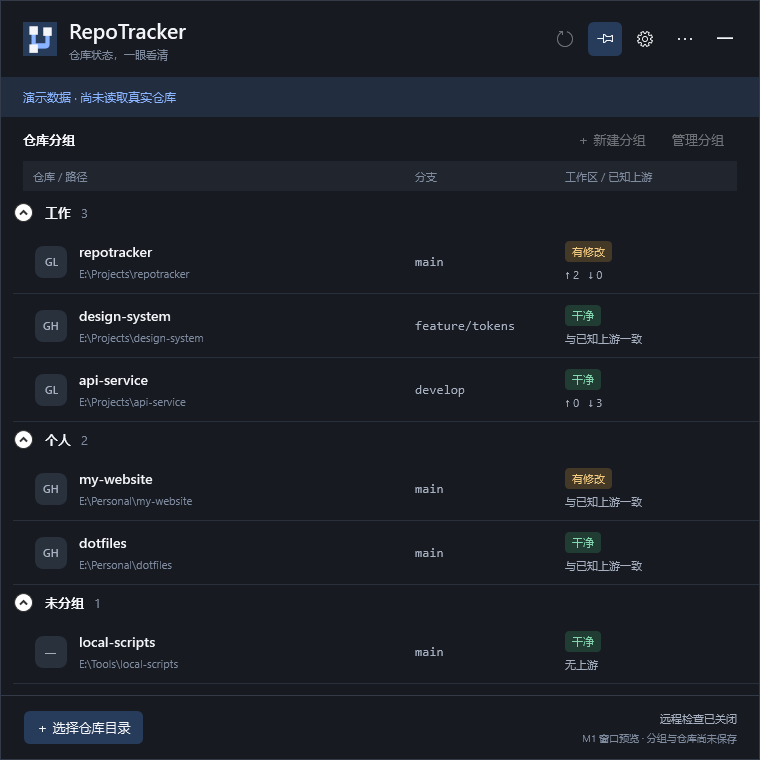

# M1 工程与任务栏窗口 — 验收记录

> 公开版本说明：本机环境信息已脱敏，示例路径与标识不用于定位原始私有产物。

2026-10-16，H-01 在本机可用环境内通过。当前交付是可启动的窗口预览，仓库与分组数据仍为演示；没有开始真实 Git 采集。任务状态统一回写[里程碑](里程碑-桌面应用开发.md)。

## 环境与命令

Windows 10 22H2 / build 19045，.NET SDK 10.0.201、Windows Desktop Runtime 10.0.5。交互桌面有两块 1920×1080 显示器，均为 96 DPI；左屏坐标从 -1920 开始。构建和测试均在原 E 盘工程运行，没有创建工程副本、分支或 worktree。

```powershell
dotnet restore RepoTracker.slnx --locked-mode --packages "$env:USERPROFILE/.nuget/packages"
dotnet build RepoTracker.slnx --configuration Release --no-restore
dotnet test RepoTracker.slnx --configuration Release --no-build --logger trx --results-directory tests/artifacts/results
dotnet test tests/RepoTracker.Desktop.Tests --configuration Release --no-build --logger trx --results-directory tests/artifacts/results
```

执行时将 `DOTNET_CLI_HOME` 指向仓库 `.artifacts/dotnet-home`，复用已有 NuGet 缓存。首次恢复因继承额外私有包源及沙箱网络限制失败；增加仓库级源配置后，在获准联网的执行环境完成锁定恢复和 NuGet 漏洞元数据检查，未禁用审计。最终恢复成功，Release 构建为 **0 警告、0 错误**。

Core **13/13**、Infrastructure **6/6** 已通过。桌面测试在修正测试宿主的 XAML 加载方式、文件就绪通知和菜单关闭等待后，在可交互执行环境通过 **1/1**；同一项包含下面的真实窗口序列。总计 **20 项通过，无跳过**。不是将早期失败的全 solution 运行记为通过；桌面项单独复验至通过。

最终桌面原始产物：`tests/artifacts/20261016-065141-ad877d77/`。对应 TRX：`tests/artifacts/results/user_WORKSTATION_2026-10-16_14_51_52.trx`。测试结束后未发现 RepoTracker 产品或测试进程残留。

## 已完成的检查

| 内容 | 实际结果 |
|---|---|
| 任务栏资格 | 主窗口无 owner，ShowInTaskbar=true，未设置 TOOLWINDOW；最小化后保留入口资格 |
| 收起与恢复 | 自动化点击收起按钮、发送标准 SC_RESTORE、向自身窗口发送 Esc，状态正确 |
| 单实例 | 启动产品 exe 作为第二进程，成功经 IPC 唤醒主窗口，第二进程返回 0；另测超时、取消、空闲客户端和监听退出 |
| 设置 | 打开真实所属设置窗口，主面板不收起，关闭后释放焦点保护 |
| 目录选择器 | 打开真实系统目录选择器，校验 owner，自动取消，主窗口不误收起 |
| 菜单 | 打开真实 ContextMenu，关闭后保护释放；通过退出菜单结束主进程 |
| 保持展开 | 用 UI Automation 激活测试窗口，再将前台交给独立测试进程，主面板继续显示 |
| 默认失焦 | 两个测试进程明确交接前台权限，观察真实前台句柄变化，主面板自动最小化 |
| 两块实屏 | 实际移动到两块 96 DPI 显示器，包含负坐标，逐屏检查窗口完全在工作区内 |
| 缩放与边界规则 | 纯规则测试覆盖 96 / 144 / 192 DPI、小工作区、负坐标、原位置失效、四边任务栏与无预留区域 |
| 视觉证据 | 渲染真实 WPF 主面板和设置内容，另输出 150% / 200% 采样；只捕获测试应用自身内容 |

窗口定位采用工作区边缘和会话内上次位置。没有声称取得应用按钮的精确图标矩形，也没有调用通知区定位接口或注入 Explorer。

## 证据与未覆盖项

已保存可随工作区阅读的[主面板截图](evidence/m1-main.png)、[设置截图](evidence/m1-settings.png)和[机器结果](evidence/m1-report.json)。主面板中的六个仓库、状态和路径都是演示数据。



以下未验证：Windows 11、真实 150% / 200% 与混合 DPI 跨屏、热拔插显示器、鼠标实际点击任务栏按钮、任务栏自动隐藏及固定快捷方式。系统消息恢复和 HWND 样式检查不能代替所有 Explorer 交互；这些组合在 M5 / M6 继续补，不影响当前 M2 的仓库与配置开发。

普通沙箱返回前台句柄 0，并只呈现一块显示器；这部分失败用于识别执行环境限制。交互桌面测试通过 UI Automation 激活本测试窗口，并让两个测试进程按 Windows 规则交接前台权限，没有对其他应用窗口发送按键或命令。

本阶段不覆盖仓库管理、分组持久化、Git、本地或远程调度、设置保存、自启、性能基线或安装包，未把这些功能计为完成。

## 仓库收尾检查

内联检查覆盖 13 个 Markdown、96 个相对链接、其中 13 个锚点及 57 个文本文件，链接、JSON 解析、敏感参数与空白检查错误 0；工具生成 JSON 的末尾换行按生成器格式保留。19 个任务 ID 唯一，完成项为 M1 的 3 项。`git diff --check` 通过，未跟踪的新文件另由上述检查覆盖。`git status --short --branch` 正常返回；Git 仍有用户全局 ignore 文件读取权限警告，未修改全局配置。保留原有 README、`.agents/` 和规划文件的既有改动，未提交、推送或创建分支。
