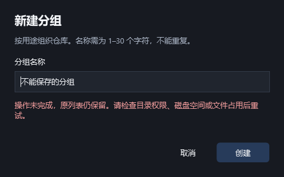
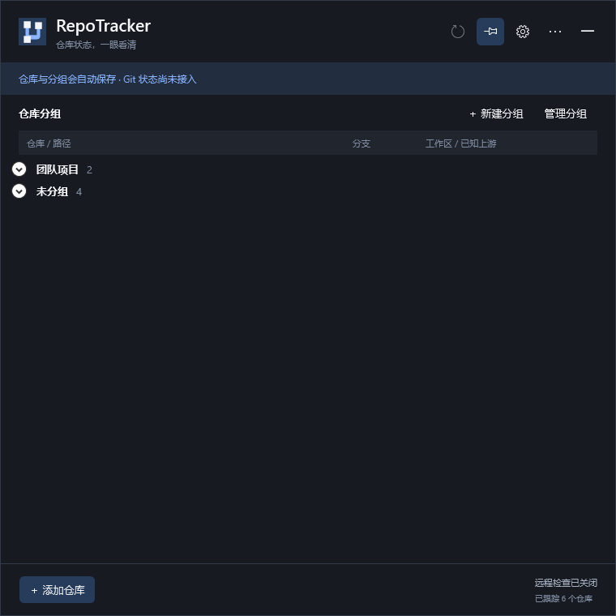

# M2 仓库、手动分组与配置验收

> 公开版本说明：本机环境信息已脱敏，示例路径与标识不用于定位原始私有产物。

2026-10-16 完成 M2-01 至 M2-04 的本机范围验证。实际管理界面使用真实配置与 Git 工作树，首次启动为空列表；Git 状态采集尚未实现，行内保持“待检查 / 尚未读取 Git 状态”。当前进度以[开发里程碑](里程碑-桌面应用开发.md)为准。

## 实际命令与结果

在仓库根目录执行，`DOTNET_CLI_HOME` 指向项目内 `.artifacts/dotnet-home`。SDK 10.0.201、WindowsDesktop Runtime 10.0.5、Windows 10 22H2（19045）、Git 2.51.0.windows.1；两块 1920×1080、96 DPI 实屏。

```powershell
dotnet restore RepoTracker.slnx --locked-mode
dotnet build RepoTracker.slnx --configuration Release --no-restore
dotnet test RepoTracker.slnx --configuration Release --no-build --logger trx --results-directory tests/artifacts/results
git diff --check
git status --short --branch
```

锁定恢复成功，Release 构建 0 警告 / 0 错误；Core **27**、Integration **24**、Desktop **1**，合计 **52 项通过，0 失败、0 跳过**。桌面 1 项包含完整操作序列与退出后的第二次独立启动，不以截图张数统计测试数量。[测试结果摘要](evidence/m2-tests.json)由本轮三份 TRX 计数生成。

本轮最终桌面运行目录为 `tests/artifacts/20261016-074430-75295fc4/`。长期保留[窗口流程报告](evidence/m2-report.json)与[重启报告](evidence/m2-reload-report.json)，原始日志、TRX、夹具及其他截图留在被忽略的 `tests/artifacts/`。测试结束未遗留 RepoTracker 桌面进程。

## H-02：仓库与配置

| 范围 | 实际证据 |
|---|---|
| 仓库身份 | 真实 Git 读取中文、空格、子目录、junction 别名；同根去重，同 commonDir 的 linked worktree 各自保留 |
| 无效路径 | 缺少 Git、目录缺失、无效 `.git` 边界拒绝添加；表单保留原输入和既有列表 |
| 移除与恢复 | 只改跟踪记录，撤销保留 ID；原分组消失时恢复到未分组；不可达仓库记录仍可读取 |
| 原子保存 | 同目录临时文件、flush、原子替换、独占锁和内容版本校验；文件占用时原文件不变、临时文件回收 |
| 恢复与兼容 | schema 1 / 缺组 / 失效 groupId 回退；损坏原字节保存在独立文件，有效备份恢复；未来 schema 和不可读文件禁止修改 |
| 外部更改 | 两个存储实例读同一版本后，旧版本不能覆盖新文件 |
| 进程回收 | 独立受控进程模拟 Git 超时及取消，确认返回后进程已退出 |
| 文件不变 | 添加、移组、删组、移除和撤销前后比较隔离夹具全部文件与 Git 元数据 SHA-256，无变化 |

永久测试输入入口：[配置测试](../../../tests/RepoTracker.IntegrationTests/ConfigurationTests.cs)、[真实仓库发现](../../../tests/RepoTracker.IntegrationTests/RepositoryDiscoveryTests.cs)、[进程回收](../../../tests/RepoTracker.IntegrationTests/GitProcessTests.cs)、[夹具构造器](../../../tests/Shared/TestWorkspace.cs)。夹具位于 E 盘测试根，使用分离 HEAD 和最小对象，linked worktree 直接构造标准 gitdir / commondir 文件；不创建命名分支、upstream 或工程副本，也不修改实际项目仓库。

## H-03：手动分组与桌面流程

Core 验证空白、控制字符、保留名称、30 / 31 个文本元素、等价 Unicode、大小写判重；验证空组、稳定 ID、唯一归属、顺序、折叠、目标组在发现期间消失、删除组保存失败及并发更新。

真实 App 的表单与控件依次完成：新建工作 / 个人组 → 六个独立仓库按 3/2/1 添加 → 无效路径与取消 → 子目录重复定位 → 工作组改名“团队项目” → 一项移到个人组 → 删除含三项的个人组 → 移除及撤销 → 文件占用时创建组失败 → 折叠 → 退出 → 新进程恢复。最终归属 2/4，总仓库集合与 ID 不变；Core 另外覆盖不额外移组时的 3/3 删除结果。

删除确认显示受影响数量；未分组的改名、删除按钮禁用。配置保存失败后输入不清空，列表不先行更新。重启确认六个 ID、团队项目名称、2/4 归属、两个折叠状态均一致。M1 的双屏定位、菜单 / 子窗口焦点保护、失焦收起、保持展开、单实例激活和退出继续通过。

实现与测试入口：[注册表规则](../../../src/RepoTracker.Core/Tracking/RepositoryRegistry.cs)、[规则测试](../../../tests/RepoTracker.Core.Tests/RepositoryRegistryTests.cs)、[桌面操作编排](../../../tests/RepoTracker.Desktop.TestHost/RepositoryProbe.cs)。

完成移组、删组和撤销后的真实列表（原截图含本机环境信息，公开版本已移除）

添加仓库并选择分组（原截图含本机环境信息，公开版本已移除）





## 本轮修复、忽略规则与边界

- 首轮集成测试发现 ImmutableArray 比较选中了集合身份重载，改为逐项比较；Git 拒绝 `--detach` 与 `--no-track` 的组合，夹具改为直接构造无命名分支的 linked worktree 元数据。修复后全部通过。
- 视觉检查发现下拉选择器显示记录类型文本、文件夹字形缺失，已改为明确的名称模板和矢量文件夹图标，并重新构建、跑全套测试和检查截图。
- 受限沙箱中的 NuGet 恢复遇到 TLS 凭据不可用，改在当前用户执行环境恢复成功。受限 Git 检查提示全局 `C:/Users/user/.config/git/ignore` 读取权限不足；当前用户环境的最终 Git 检查无此告警，未修改用户全局配置。真实桌面测试在有交互桌面访问能力的环境执行。
- `.gitignore` 覆盖 bin / obj、TestResults、覆盖率与 binlog、编辑器状态、`.artifacts/`、`tests/artifacts/`、根目录 `publish/` 与 `.local/`；`git check-ignore` 已验证命中。源码、package lock、`.agents` 和正式验收证据均不忽略。
- 使用文件占用验证拒绝读写与原子替换失败，未模拟真实断电、磁盘硬件故障或修改 ACL。打开目录已验证适配目标及不可达失败，不把资源管理器窗口内容读取记作已验证。
- Windows 11、物理高 DPI / 混合 DPI、实际任务栏鼠标点击 / 固定 / 自动隐藏和显示器热拔插继续留待 M5 / M6。最终观感仍可调整，当前截图只证明本机布局。
- 本轮不包含本地状态解析、定时采集、来源识别、远程 fetch、设置持久化或发行安装包；分别由 M3–M6 继续。没有提交、推送或创建项目分支，用户原有修改保留。

文档与仓库检查：内联检查覆盖 70 个源码 / 文档 / JSON 文件、119 个相对链接、14 个锚点，错误 0；`git diff --check` 通过，当前用户环境 `git status` 与忽略规则检查通过，桌面测试进程残留 0。未生成一次性验证脚本。

记录日期：2026-10-16。
