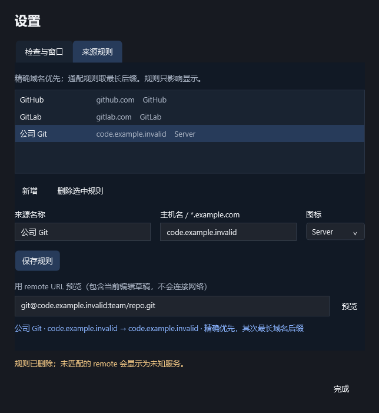
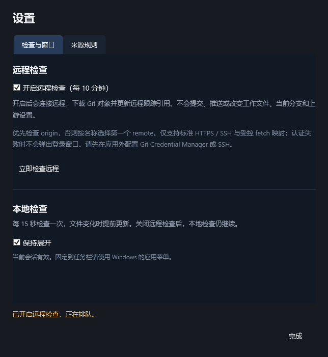

# M4 来源识别与远程检查验收

> 公开版本说明：本机环境信息已脱敏，示例路径与标识不用于定位原始私有产物。

2026-10-16 完成 M4-01 至 M4-03 的本机范围验收。真实面板显示来源标识，设置支持来源规则增改删、草稿匹配预览与持久化远程开关；默认关闭远程，开启后按受控策略执行 fetch。进度以[开发里程碑](里程碑-桌面应用开发.md)为准。

## 命令与结果

Windows 10 22H2（19045）、.NET SDK 10.0.201、WindowsDesktop Runtime 10.0.5、Git 2.51.0.windows.1，两块 1920×1080 / 96 DPI 实屏。无新增依赖；`DOTNET_CLI_HOME` 使用项目 `.artifacts/dotnet-home`。实际执行：

```powershell
dotnet restore RepoTracker.slnx --locked-mode
dotnet build RepoTracker.slnx --configuration Release --no-restore
dotnet test tests/RepoTracker.Core.Tests --configuration Release --no-build --logger trx --results-directory tests/artifacts/results
dotnet test tests/RepoTracker.IntegrationTests --configuration Release --no-restore --logger trx --results-directory tests/artifacts/results
dotnet test tests/RepoTracker.Desktop.Tests --configuration Release --no-build --logger trx --results-directory tests/artifacts/results
```

锁定恢复成功；Release 构建 **0 警告 / 0 错误**。最终 **Core 80、Integration 56、桌面 1，共 137 项通过，0 失败、0 跳过**。见 [TRX 摘要](evidence/m4-tests.json)。桌面测试包含完整 M1–M4 操作序列与独立进程重启，不是仅验证窗口能打开。

最终桌面原始证据目录为 `tests/artifacts/20261016-084624-6be67f72/`。长期保存[窗口报告](evidence/m4-report.json)、[重启报告](evidence/m4-reload-report.json)与截图；原始 TRX、日志、profile、夹具保留在被忽略的测试目录。所有夹具位于 E 盘，没有复制工程到 C 盘。

## H-06 覆盖与证据

| 场景 | 实际验证 |
|---|---|
| URL 解析 | HTTPS、SSH 含端口、scp、大小写、末尾点、带认证参数的输入只提取 host；本地绝对 / 相对路径、非法协议和控制字符回退 |
| 匹配 | 默认 GitHub / GitLab；精确优先、最长通配后缀、根域不命中 `*.`、恶意相似后缀不命中、重复与非法规则拒绝；本地 / 未知 / 待检查分开 |
| 规则维护 | 真实设置页新增、改名、删除、非法输入保留、scp 草稿预览；立即更新面板标识，读取前后 remote 配置字节相同 |
| 配置兼容 | schema 1 / 2 升到 3 后远程保持关闭，填入初始规则；schema 3 的空规则集与远程开关正确往返，桌面重启恢复编辑后的规则与关闭状态 |
| 目标与边界 | origin 优先，否则 ordinal 名称顺序；多 URL、mirror、upload-pack、URL 重写、危险映射拒绝；禁止指向本地分支 / tags / 其他 remote 的目的引用 |
| 符号引用 | 模拟 remote-tracking ref 指向本地分支，跳过 fetch；排除惯用的 `refs/remotes/<remote>/HEAD` 更新目标 |
| fetch 参数 | 用记录型进程验证显式 URL / refspec、空 refmap、负 HEAD refspec、atomic、禁 tags / prune / 子模块 / FETCH_HEAD / 自动维护 / commit-graph / hooks |
| 凭据与日志 | 真实子进程核对非交互环境与 SSH BatchMode、严格主机校验；替身注入含秘密的认证错误，UI 错误不包含原始 URL 或秘密 |
| 调度 | 默认 OFF 不调用检查；开启、快速关闭再开启、移除、暂停、恢复、退出取消和过期结果保护；同 commonDir 串行；可控时钟验证 10 分钟周期和 1 秒错峰 |
| 失败与恢复 | 替身验证认证、离线、超时、成功、失败保留最近成功时间与再次成功恢复；成功请求本地重新检查 |
| 真实网络进程 | 在测试自有回环 TCP 端点上让真实 Git / SSH 等待握手，3 秒超时回收；Git 配置不变，未产生 FETCH_HEAD 或引用 |
| 真实界面 | 默认关闭、开启后六个无 remote 夹具显示跳过、期间本地刷新继续、保存关闭、来源编辑与重启；从未成功时不伪造成功时间 |

永久入口：[来源规则测试](../../../tests/RepoTracker.Core.Tests/SourceRulesTests.cs)、[远程调度测试](../../../tests/RepoTracker.Core.Tests/RemoteSchedulerTests.cs)、[Git 与配置集成测试](../../../tests/RepoTracker.IntegrationTests/RemoteTests.cs)、[进程回收](../../../tests/RepoTracker.IntegrationTests/GitProcessTests.cs)、[真实设置流程](../../../tests/RepoTracker.Desktop.TestHost/RemoteProbe.cs)。





来源标识与独立本地、远程状态（原截图含本机环境信息，公开版本已移除）

## 实现口径

来源与本地状态一起读取，关闭远程仍能显示来源。规则只改应用 JSON 和展示，不改仓库 remote URL。原始 URL 仅在 Git 适配器中短暂使用，不进入 profile 或会话日志。预览 URL 不持久化、不连接网络。

远程全局并发为 1，共用 commonDir 的不同工作树仍保留独立条目，轮到各自时串行检查。间隔从检查完成计算；配置读取限时 10 秒，fetch 限时 60 秒。开启与关闭均以配置保存成功为准；暂停、移除和退出取消任务，关闭再开启不能接收上一轮的晚到结果。远程失败不清空本地状态，成功后触发本地重新读取。

支持标准 HTTPS / SSH 和单一同名 heads → remote-tracking 映射；HTTPS 凭据助手限定 Git Credential Manager，SSH 使用已有非交互凭据与已确认主机。非标准配置明确跳过，需用户在应用外处理。远程成功只表示本次选定 remote 检查成功，当前分支的 upstream 可能属于别的 remote；ahead / behind 始终表示本地已知上游比较。成功时间只在当前会话保存，重启重新检查。

## 失败修复与边界

- 沙箱中首次测试自动恢复遇到 NuGet 漏洞源访问失败 NU1900；随后在正常用户执行环境完成锁定恢复，未禁用漏洞检查，也未新增依赖。
- 取消传播测试先前立即断言子令牌状态，早于 `CancelAsync` 的传递；改为等待取消条件后断言与回收。
- UI Automation 的按钮调用异步投递事件。测试已在“新增”后等待表单状态、保存后等待页签恢复可用；失败清理也等待保存结束后关闭，避免在保存中的关闭保护下遗留弹窗。失败运行保留原始产物，最终摘要只收录通过记录。
- 实屏截图发现来源列表禁用时继承系统白底，已改为应用自己的暗色模板；设置高度调整为 740，匹配预览与完成按钮完整可见。最终截图已逐张检查。
- 进程测试曾在 PID 文件刚创建但尚未关闭时读取，出现共享冲突。改为写完临时文件再原子发布，并在测试失败时也取消、等待所启动的进程。
- **未访问真实服务、未使用真实凭据，也未创建命名分支或 upstream。成功 fetch / 认证失败 / 引用更新策略由替身验证；真实 Git 的成功下载及 remote-tracking 引用更新尚未在获准的专用分支夹具上验收。** 本机回环测试只验证连接、参数可执行及超时回收，不冒充成功 fetch 验证。
- 图标类型目前使用 Git / GH / GL / 自建和未知问号标识；官方品牌素材、用户导入图形、主题、完整设置、长列表 / 高 DPI 适配留待 M5 / M6。10 分钟周期用可控时间验证，未进行实际十分钟联网轮询。
- Windows 11、物理高 DPI / 混合 DPI、任务栏实际点击 / 固定 / 自动隐藏、热拔插与物理睡眠仍未覆盖。性能门槛及安装包在 M6 验收。
- 未提交或推送；既有 README、`.agents/` 及 M1–M3 未提交改动保留。原始产物继续由现有 `.gitignore` 覆盖，M4 源码、测试和本记录未忽略。

实现依据：[git-fetch 引用映射及选项](https://git-scm.com/docs/git-fetch)、[Git 配置与 hooks](https://git-scm.com/docs/git-config)、[Git Credential Manager 非交互配置](https://github.com/git-ecosystem/git-credential-manager/blob/main/docs/environment.md)。

收尾检查：97 个源码 / 文档 / JSON 文件、153 个相对链接、15 个锚点均通过；JSON 按语法校验，保留序列化原始报告与 package lock 的既有结尾格式。`git diff --check` 通过，正常用户环境 Git 复查无警告，源码与 M4 证据未被忽略；RepoTracker 窗口与本次夹具 Git / SSH / PowerShell 子进程残留为 0。受限沙箱出现过全局 ignore 读取权限提示，未修改全局配置。

记录日期：2026-10-16。
