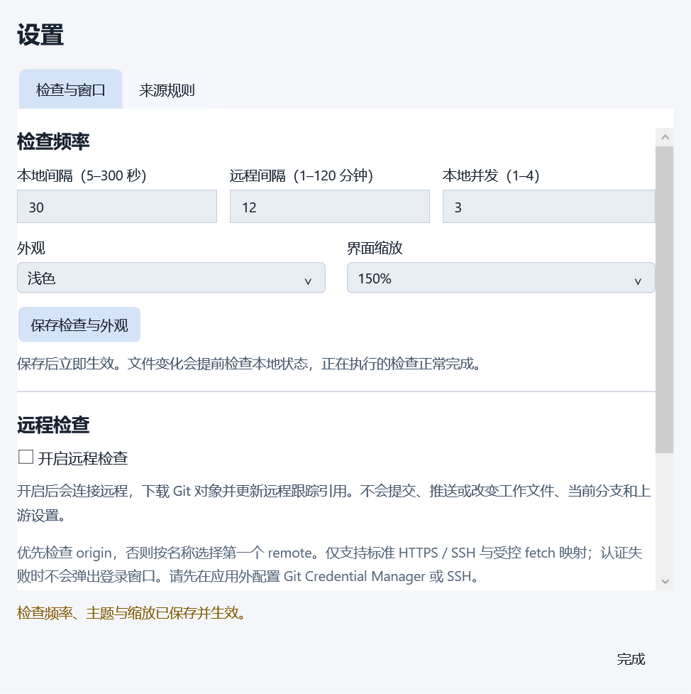

# M5 完整交互与桌面适配验收

> 公开版本说明：本机环境信息已脱敏，示例路径与标识不用于定位原始私有产物。

2026-10-16 完成 M5-01 至 M5-03 的本机范围验收。设置支持本地 / 远程间隔、并发数、深浅主题、应用缩放、保持展开与登录启动；来源使用矢量图形，长列表、键盘路径、错误恢复和新进程恢复已接入真实 WPF 回归。唯一进度入口为[开发里程碑](里程碑-桌面应用开发.md)。

## 命令与结果

Windows 10 22H2（19045）、.NET SDK 10.0.201 / Runtime 10.0.5、Git 2.51.0.windows.1，两块 1920×1080 / 96 DPI 显示器。沿用七份依赖锁文件，没有新增 NuGet 依赖。`DOTNET_CLI_HOME` 位于项目 `.artifacts/dotnet-home`，所有 profile 和 Git 夹具位于 E 盘 `tests/artifacts`，没有工程副本。

实际执行：

```powershell
dotnet restore RepoTracker.slnx --locked-mode
dotnet build RepoTracker.slnx --configuration Release --no-restore
dotnet test tests/RepoTracker.Core.Tests --configuration Release --no-build --logger trx --results-directory tests/artifacts/results
dotnet test tests/RepoTracker.IntegrationTests --configuration Release --no-build --logger trx --results-directory tests/artifacts/results
dotnet test tests/RepoTracker.Desktop.Tests --configuration Release --no-build --logger trx --results-directory tests/artifacts/results
```

锁定恢复成功，Release 构建 **0 警告 / 0 错误**。**Core 97、Integration 64、桌面 1，共 162 项通过，0 失败 / 0 跳过**。桌面项运行完整 M1–M5 操作序列、重启恢复和独立收起启动，不是单个启动断言。见 [TRX 摘要](evidence/m5-tests.json)。最终原始证据目录为 `tests/artifacts/20261016-094216-cf0ce239/`，原始 TRX、日志和隔离夹具保留在忽略目录。长期保存[主流程报告](evidence/m5-report.json)、[重启报告](evidence/m5-reload-report.json)及[收起启动报告](evidence/m5-minimized-report.json)。

## H-07 实际覆盖

| 场景 | 验证结果与口径 |
|---|---|
| 检查设置 | 默认本地 15 秒 / 远程 10 分钟 / 并发 2；支持 5–300 秒、1–120 分钟、并发 1–4。上下界、非法整数、枚举和缩放校验通过 |
| 即时调度 | 可控时钟验证修改间隔后重新排队；改变频率不启用远程、不取消活动 fetch；降低本地并发等待活动检查完成，提高上限继续派发；文件事件不会被设置修改延后 |
| 保存事务 | 并行修改不同设置不会互相覆盖；无效值和真实文件占用均保留原状态与输入；解除占用后可保存 |
| 配置升级 | schema 1 / 2 仍默认关闭远程；schema 3 升到 4 保留已保存远程开关和来源规则，新增偏好使用默认值；完整偏好往返通过 |
| 主题与缩放 | 深浅资源即时切换，状态颜色随主题且保留文字；主窗口与设置验证 100% / 125% / 150% 应用缩放；窗口物理边界保持在实际工作区内 |
| 长列表与空组 | 在原六仓库基础上加入 14 个隔离真实工作树，构成 20 仓库 / 7 分组，含空组和长名称 / 路径；滚动后行菜单仍可用，标题与底部入口保留 |
| 小视口 | 仅调整测试窗口到 800×600，在 150% 应用缩放下验证横纵滚动及底部添加入口位置；没有修改系统显示设置 |
| 长分支 | 将长分支协议样例注入真实行模型检查完整提示；不为验收创建命名分支或 upstream，真实 Git 夹具保持分离 HEAD |
| 键盘 | 设置页 Tab 移动字段、Esc 关闭并返回触发按钮；分组表单 Enter 保存、Esc 取消；此前 M1 的主窗口 Esc / 单实例激活与 M2–M4 操作继续回归 |
| 可访问性 | 数字字段、主题、缩放、来源字段有明确名称；仓库行操作名称含仓库名；错误区域 live setting，完整长文本悬停提示。未宣称完成屏幕阅读器用户测试 |
| 图标 | 官方 GitHub Octicons、GitLab SVG 路径转 WPF Geometry；本地、服务器、未知采用项目图形。只读 remote 匹配，关闭远程时来源仍可显示 |
| 保持展开 | 标题图钉与设置开关共用已保存偏好；失焦、弹窗保护、退出后新进程读回均通过 |
| 自启开关 | UI 使用文件存储替身，覆盖开启、关闭、拒绝写入回退和新进程恢复；系统适配用内存存储验证命令引用、根路径、260 字符上限、profile 隔离和外来值保留，未写真实 HKCU Run |
| 收起启动 | 实际产品第二进程带 `--minimized` 时直接退出、不唤醒现有面板；真实 App 的独立测试进程以该参数启动，保持任务栏可见、最小化且未激活 |
| 回归与退出 | M1–M4 的真实对话框、菜单、文件选择器、源规则、远程开关、本地状态、保存失败、组归属和新进程恢复全部回归；主流程退出等待状态任务停止 |

长期测试入口：[偏好与布局桌面回归](../../../tests/RepoTracker.Desktop.TestHost/PreferencesProbe.cs)、[登录启动适配测试](../../../tests/RepoTracker.IntegrationTests/StartupRegistrationTests.cs)、[配置迁移](../../../tests/RepoTracker.IntegrationTests/ConfigurationTests.cs)、[本地调度](../../../tests/RepoTracker.Core.Tests/StatusSchedulerTests.cs)、[远程调度](../../../tests/RepoTracker.Core.Tests/RemoteSchedulerTests.cs)。

## 实际窗口截图

以下均来自最终通过的桌面运行，已逐张复核。图标匹配使用测试夹具中的 host，远程开关保持关闭，没有向对应服务发请求。

浅色 125%：长列表与 GitHub / GitLab 来源（原截图含本机环境信息，公开版本已移除）

深色 150%：长列表与空组（原截图含本机环境信息，公开版本已移除）

800×600 视口、150% 应用缩放：滚动区域与固定操作（原截图含本机环境信息，公开版本已移除）



其他证据：[深色设置与隔离自启](evidence/m5-settings-dark.png)、[来源规则](evidence/m5-source-rules.png)、[保存失败保留输入](evidence/m5-preferences-save-failure.png)、[新进程恢复浅色与折叠](evidence/m5-restart.png)。

## 本轮修复

- 初次桌面回归发现主题资源相对路径依赖入口程序集，测试宿主无法载入浅色字典；改用 Desktop 程序集限定路径。
- 水平滚动容器按无限宽测量，导致长文字撑开设置页与仓库列表；内容宽度绑定视口，同时保留小屏所需最小宽度和横向滚动。
- 弹窗关闭的同一调用帧恢复焦点会被 owner 激活覆盖；改为模态帧退出、布局稳定后恢复，数据模板重建时按稳定仓库 / 分组 ID 查找替代控件。
- 旧来源编辑测试的等待条件与“新增”提示文本重合，偶发在保存未执行前继续操作；清空旧反馈并等待准确校验结果和页签恢复可用。不是通过增加任意等待时间掩盖失败。
- 小视口截图默认 VisualBrush 取景会包含滚动内容范围，造成画面被压缩；取景改为控件实际视口。截图仅含本次应用内容。

## 验收边界

应用缩放与渲染采样不是物理系统 DPI。Windows 11、物理 150% / 200% 和混合 DPI、实际任务栏鼠标点击 / 固定 / 自动隐藏、显示器热拔插及物理睡眠尚未覆盖；当前两块 96 DPI 实屏的定位与真实失焦已回归。

未写本机真实启动项、注销或重启 Windows，因此真实登录、Windows 启动项禁用策略、安装升级后的路径变化和卸载清理仍需 M6 交付环境验证。设置登记的是当前运行 exe；开发目录不是最终安装目录。运行时不自动补写启动项。

来源图标支持内置类型，不包含图形文件导入。许可及来源见[第三方图标说明](../../../THIRD-PARTY-NOTICES.md)。未访问真实 Git 服务、使用真实凭据、创建命名分支或 upstream；M4 成功 fetch 与真实远端的未覆盖边界继续保留。性能门槛、安装包和签名属于 M6。

最终观感仍属于主观验收；Codex 已执行实际窗口操作、尺寸断言和截图复核，不要求用户重新运行自动化。

未提交、推送或创建分支；用户既有 README、`.agents/` 及 M1–M4 未提交改动保留。现有 `.gitignore` 已覆盖新增运行产物，源码、第三方声明和正式证据保留在版本范围内。

收尾检查：119 个源码 / 文档 / 配置文件、178 个相对链接、15 个锚点通过，JSON 语法、空白和敏感参数扫描无错误。`git diff --check` 通过，正常用户环境复查无警告；受限环境出现的全局 ignore 读取权限提示未通过修改用户配置处理。测试进程残留为 0，隔离自启文件已移除。截图最终修正了 LayoutTransform 与外边距的取景坐标，主面板、设置页、来源页和重启画面均已复核。

记录日期：2026-10-16。
